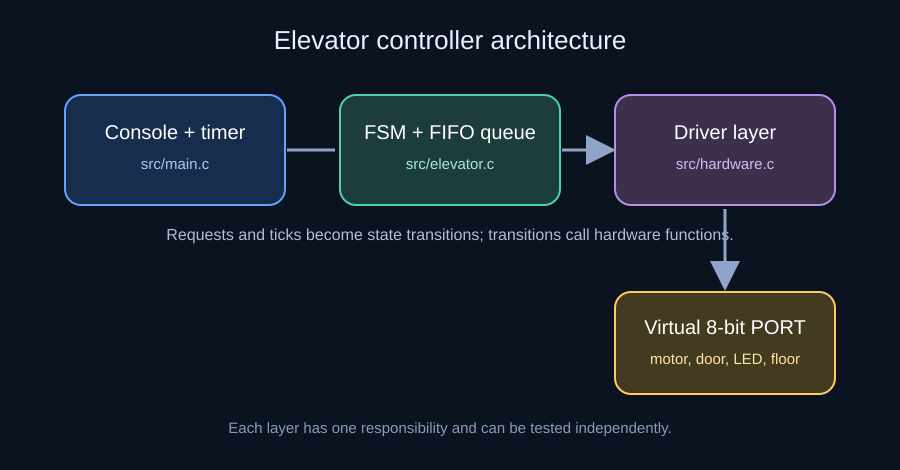
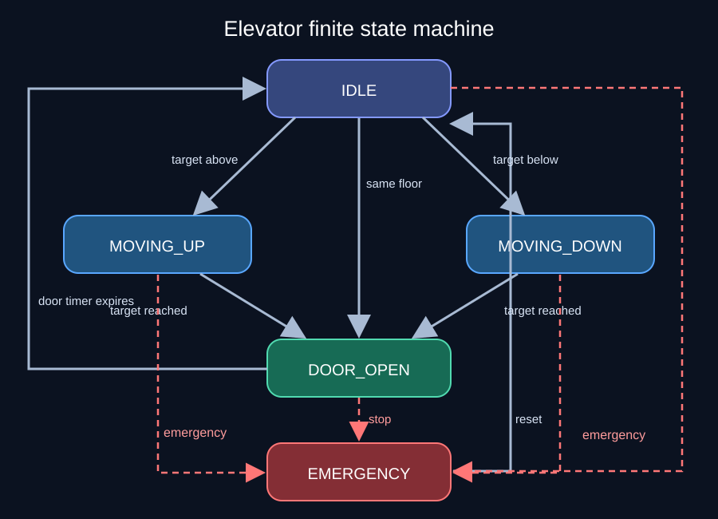
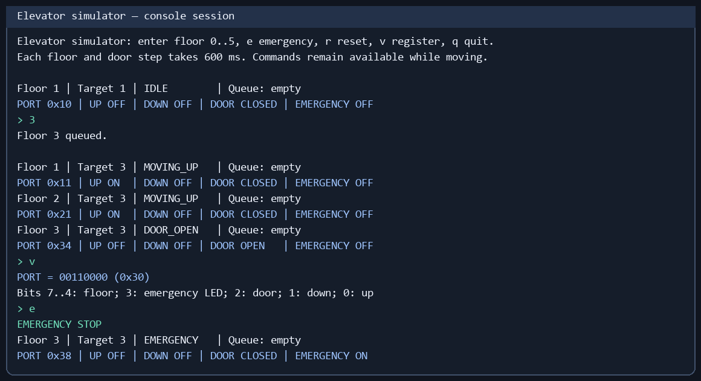

# Embedded Elevator Controller

A C11 elevator simulator designed to demonstrate an embedded-style finite state machine (FSM), a hardware driver layer, bitwise register operations, and a FIFO floor-request queue. The console stays responsive while the elevator moves, so new calls and emergency stops can be entered at any time.

> Educational simulation only. It does not control a physical elevator.

## Architecture



| Layer | Files | Responsibility |
| --- | --- | --- |
| Console and timer | `src/main.c` | Read commands and issue a tick every 600 ms without blocking input |
| Controller | `src/elevator.c`, `include/elevator.h` | Own state transitions, current and target floors, door timer, and FIFO queue |
| Driver | `src/hardware.c`, `include/hardware.h` | Set and clear motor, door, LED, and floor-indicator register bits |
| Tests | `tests/test_elevator.c` | Check controller transitions and resulting register values |

The controller calls driver functions instead of changing register bits directly. The driver closes the door and clears the opposite motor bit before starting a motor. The controller stops the motor before opening the door.

## State diagram



An IDLE request starts travel or opens the door immediately if the elevator is already at that floor. Each movement tick advances one floor. Reaching the target opens the door for two ticks, then returns to IDLE. An emergency command from any state stops the motor, clears pending calls, and rejects new calls until reset. Reset keeps the current simulated floor.

## Register mapping

The simulator uses one virtual `volatile uint8_t` PORT. The controller holds a pointer to it through `Hardware`.

| Bit | Mask | Meaning | Set when |
| --- | --- | --- | --- |
| 0 | `0x01` | Up motor | Moving up |
| 1 | `0x02` | Down motor | Moving down |
| 2 | `0x04` | Door | Open |
| 3 | `0x08` | Emergency LED | Emergency active |
| 4–7 | `0xF0` | Floor indicator | Binary value of current floor |

For example, `0x21` (`0010 0001`) means floor 2 with the up motor running. `0x34` means floor 3 with the door open. The two motor bits are never intentionally set together.

## Simulation demo

The image below presents output captured from a simulator run: a request for floor 3, movement, arrival, register display, and emergency stop.



Commands are entered one per line:

| Command | Action |
| --- | --- |
| `0` to `5` | Request a floor |
| `e` | Emergency stop |
| `r` | Reset at the current floor |
| `v` | Print PORT bits and their meanings |
| `h` | Show help |
| `q` | Quit |

Requests are served in FIFO order. Duplicate pending requests are ignored. A tick is a simulation step; floor position is not read from a real sensor.

## Build & run with GCC

On Ubuntu, install GCC and Make if needed:

```sh
sudo apt update
sudo apt install build-essential
```

Then build, test, and run:

```sh
make
make test
make run
```

Equivalent direct GCC commands:

```sh
gcc -std=c11 -Wall -Wextra -Wpedantic -Werror -Iinclude \
  src/main.c src/elevator.c src/hardware.c -o elevator_sim
./elevator_sim

gcc -std=c11 -Wall -Wextra -Wpedantic -Werror -Iinclude \
  tests/test_elevator.c src/elevator.c src/hardware.c -o test_elevator
./test_elevator
```

GitHub Actions runs `make` and `make test` on Ubuntu for each push and pull request.

## Repository layout

```text
include/           Controller and driver interfaces
src/               Simulator, FSM, and virtual hardware driver
tests/             Assertion-based unit tests
docs/              Architecture, state diagram, and demo images
.github/workflows/  Build and test workflow
Makefile           Build, run, test, and clean targets
```

## Scope and limitations

The simulator models one elevator with floors 0–5 and a FIFO queue. It does not optimize stops based on travel direction. A physical system would additionally need sensors, independent safety circuits, fault handling, and a certified design.

